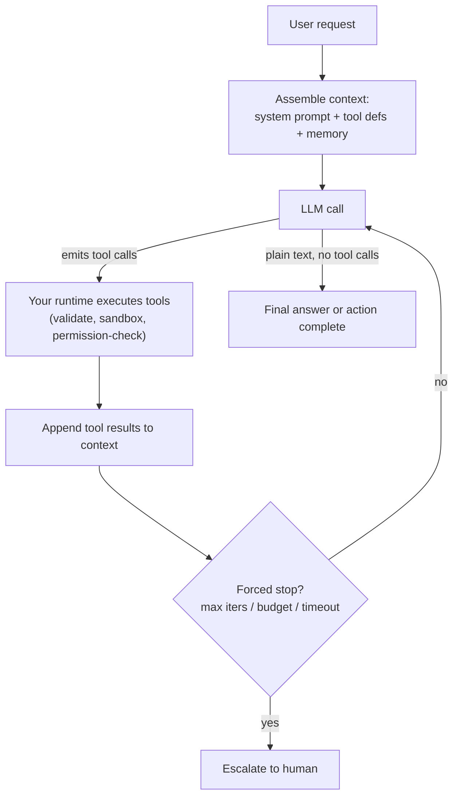

# 🤖 Agents, Tool Use & MCP

One of the most heavily tested AI engineering topics of 2025-2026. Every frontier lab, big tech AI team, and agent startup asks about it, and it dominates system-design rounds for AI engineer, GenAI engineer, and LLM platform roles. Interviewers use it to separate people who have shipped an agent to production from people who have watched a demo - the questions probe reliability math, security, and cost engineering, not just vocabulary.

## Crash course

### Workflows vs agents

Anthropic's framing (from *Building Effective Agents*) is the standard interview vocabulary. **Workflows** orchestrate LLMs and tools through *predefined code paths* - prompt chaining, routing, parallelisation, orchestrator-workers, evaluator-optimizer. **Agents** let the LLM *dynamically direct its own process*: it decides which tools to call, in what order, and when it's done. Agency is a dial, not a binary. Every notch toward agency buys flexibility and costs predictability, latency, money, and evaluability.

**The most important design rule:** if you can draw the flowchart, write the workflow. Reach for an agent only when the number of steps and the branching genuinely can't be enumerated up front ("fix this failing test", "research this company"), and the value of solving it exceeds the cost of the loop.

### The core agent loop

An agent is: **a model + tools + context/memory, running in a loop, with stop conditions.** That's it.



The skeleton fits on one screen of Python; production versions wrap the same shape in retries, streaming and tracing. Interviewers frequently ask you to sketch it:

```python
def run_agent(user_msg: str, tools: list, max_iters: int = 15):
    messages = [{"role": "user", "content": user_msg}]
    spend = Budget(max_tokens=500_000, max_cost_usd=5.0)
    for _ in range(max_iters):
        resp = llm(messages, tools=tools)        # model may emit tool calls
        messages.append(resp.message)
        spend.add(resp.usage)
        if not resp.tool_calls:                  # natural stop: text-only reply
            return resp.text
        for call in resp.tool_calls:             # YOU execute; the model never does
            result = execute(call.name, call.arguments)   # validate args, sandbox,
            messages.append(tool_result(call.id, result)) # gate irreversible actions
        if spend.exceeded():
            break
    return escalate_to_human(messages)           # never loop forever
```

### Tool calling mechanics

- You pass **tool definitions** - name, description, **JSON Schema** for parameters - with every request. They consume input tokens.
- The model doesn't execute anything. It emits a **structured message**: tool name + JSON arguments + a call ID. Models are post-trained (SFT + RL) to produce this format; providers can additionally use **constrained decoding** (e.g., `strict: true` tool definitions on the OpenAI and Anthropic APIs) to guarantee schema-valid arguments. Valid is not the same as correct: a well-formed call can still carry a fabricated ID.
- Your code executes the call and appends a **tool result message** keyed by the call ID. The loop continues.
- **Parallel tool calls:** the model can emit several independent calls in one turn (fetch three URLs); execute them concurrently and return all results.
- **Tool choice forcing:** `auto` (model decides), `required`/`any` (must call *some* tool), a specific named tool, or `none`. Support is provider- and model-dependent: Anthropic's newest models reject forced tool choice and recommend `auto` with strict tool use, so guaranteed schema-valid output now comes from structured outputs or strict schemas rather than from forcing an `extract_*` tool.

### Tool design

The highest-leverage, least-glamorous part of agent engineering:

- **Few, distinct, well-named tools.** Overlapping tools ("search", "find", "lookup") cause wrong-tool errors. Namespace related tools (`jira_create_issue`).
- **Descriptions are prompts.** Write them like docs for a new hire: what it does, when to use it, when *not* to, argument semantics, an example.
- **Consolidate predictable chains.** `schedule_meeting(attendees, when)` beats `list_users` → `get_availability` → `create_event`: fewer round trips, fewer error opportunities. Keep tools granular only where the model genuinely needs to branch. Map tools to *intents*, not API endpoints.
- **Token-efficient outputs.** The agent pays for every result token for the rest of the trajectory. Paginate, filter, return semantic IDs, truncate with pointers, or write large results to a file and return the path.
- **Errors the model can act on.** Return failures as tool results, not crashes: "invalid `status`; valid values: open, closed, merged" turns a dead end into a course correction. Raw stack traces waste tokens and mislead.

### Large tool surfaces: tool search and code execution

Connect six MCP servers and you can have 100+ tool definitions and tens of thousands of schema tokens in context before the user types. Prompt caching handles the cost; it does nothing for accuracy, because wrong-tool errors grow with the number of near-synonymous options. The levers:

- **Curate and split:** allowlist tools per agent rather than per server, namespace by service, and give each subagent only its own domain's tools.
- **Progressive disclosure:** keep a small always-loaded set plus a `search_tools(query)` or per-domain loader that pulls definitions in on demand, turning tool selection into retrieval. Some provider APIs now offer this as built-in tool search with deferred loading.
- **Code execution:** present tools as a typed code API inside a sandbox. The agent reads only the modules it needs and writes a script that composes calls, so large intermediate results are filtered in the sandbox and only the final output enters context. The price is a real sandbox to operate, approval gates moved to a broker that sees each side-effecting call, and tracing inside the sandbox.

### MCP (Model Context Protocol)

**Problem:** N apps × M integrations = N×M bespoke adapters. MCP (open standard released by Anthropic in Nov 2024, donated to the Linux Foundation's Agentic AI Foundation in Dec 2025, and supported across the OpenAI, Google and Microsoft ecosystems) standardises the interface so it's N+M: build a server once, any MCP host can use it.

**Architecture:** a **host** (Claude Desktop, an IDE, your app) runs one **client** per connection to a **server** (which wraps a data source or API). Messages are JSON-RPC 2.0. Since the **2026-07-28** revision the protocol is stateless: the `initialize` handshake and `Mcp-Session-Id` header are gone, and every request carries its own protocol version and capabilities, so any server instance behind a plain load balancer can answer it. The old handshake remains as the compatibility path for revisions up to 2025-11-25.

- **Server primitives:** **tools** (model-controlled actions), **resources** (app-controlled data/context), **prompts** (user-invoked templates).
- **Client features:** **elicitation** (the server asks the user for input mid-call), which in 2026-07-28 became a multi round-trip request: the server returns an input-required result and the client re-issues the call with the answers. **Sampling** (server borrows the host's LLM), **roots** (filesystem scoping) and logging are deprecated in 2026-07-28, with at least twelve months before any removal.
- **Transports:** **stdio** (server as local subprocess - simple, inherits local privileges) and **Streamable HTTP** (remote servers, OAuth-based authorization; replaced the older HTTP+SSE transport in the 2025-03-26 revision).

**Security:** a third-party MCP server injects untrusted text (tool descriptions, results) into your model's context and, over stdio, runs code on your machine. Tool poisoning, rug-pull description updates, and tool shadowing are real attack classes - audit, pin versions, run least-privilege.

### A2A (agent-to-agent)

MCP is the **vertical** axis: agent down to tools and data you control. **A2A** is the **horizontal** axis: agent across to a *peer agent*, usually over a team or company boundary. It reached **v1.0** (still the latest release) and in August 2026 joined the **Agentic AI Foundation** as a Growth Stage project, so A2A and MCP now share one Linux Foundation home. It is backed by more than 150 organisations (AWS, Cisco, Google, IBM, Microsoft, Salesforce, SAP and ServiceNow among them). "MCP vs A2A, and how do they compose" is now a standard agent-infra screening question.

- **Agent Card:** JSON metadata published at a well-known URI declaring identity, skills, endpoint, authentication requirements, and optional capabilities (streaming, push notifications). Can be signed with **JWS** so a caller can verify it.
- **Tasks, not calls:** a task has a lifecycle - submitted, working, completed, failed, canceled, rejected, plus the interrupted states **input-required** and **auth-required**. Updates arrive by polling, streaming, or push to a webhook, because a peer's task may run for minutes.
- **Opacity is the design property:** peers collaborate on *declared capabilities* without exposing internal prompts, tools, memory, or reasoning. You get a black box with a contract, not a function - which is exactly why it isn't "MCP with extra steps."
- **Across an org boundary:** per-peer credentials (OAuth 2.0 client credentials, mTLS) rather than a shared token, dual-principal audit (which peer, acting for which end user), the peer's output treated as **untrusted content** like any tool result, and per-peer quotas and depth limits because denial of wallet is the likely incident.

They compose: your agent uses MCP for your systems and A2A to reach a vendor's agent, which uses its own MCP servers you never see.

### Agent Skills (SKILL.md)

A **skill** is a folder with a `SKILL.md` (YAML frontmatter - at minimum `name` and `description` - plus Markdown instructions), optionally bundling `scripts/`, `references/`, and `assets/`. Loaded by **three-stage progressive disclosure**: name and description at startup, full instructions when a task matches, bundled files on demand. Published by Anthropic as an open standard in December 2025, donated to the **Agentic AI Foundation** on 22 October 2026, and now used by more than 70 agent platforms according to Anthropic, including Claude Code, ChatGPT/Codex, Cursor, VS Code, GitHub Copilot, Gemini CLI, Goose, Kiro, Databricks, Snowflake and JetBrains Junie. MCP servers can also serve skills through the official **Skills extension** (SEP-2640, Beta), which binds a user's approval to the SHA-256 digests of every file in the skill, so a changed file revokes it.

**The decision rule:** tools and MCP servers give an agent a *capability or connection* it lacks; skills give it *procedural knowledge* about work it can already technically do; RAG gives it *facts*. Skills are also a **supply-chain artifact** - executable instructions plus scripts, loaded into a context holding your credentials - so review, pin, and provenance apply exactly as they do to a dependency.

### Planning patterns

- **ReAct** (Yao et al., 2022): interleave Thought → Action → Observation. Adaptive but myopic. Modern tool-calling and reasoning models internalise much of it.
- **Plan-then-execute:** produce a plan up front, execute steps (parallelisable, cheaper models per step), replan on failure. Better for long tasks and human review of plans; brittle when the environment surprises you.
- **Reflection / self-critique:** generate → critique → revise. Works best when verification is easier than generation and grounded in external signals (test results, compilers) - models grade their own work leniently. Returns diminish fast after 1-2 rounds.

### Multi-agent and subagents

The real win of **orchestrator-worker / subagent** patterns is **context isolation**: a worker burns 100k tokens searching and returns a 1k-token summary, keeping the orchestrator's context clean. Parallelism and specialisation are secondary.

Multi-agent **helps** on read-heavy, parallelisable work (research: many independent leads). It **hurts** on write-heavy work with shared state (multiple agents editing one codebase conflict), and it's expensive - Anthropic reported their multi-agent research system used ~15× the tokens of a chat interaction. **Handoffs** (transfer conversation control to a specialist agent) suit distinct domains like support triage; orchestration suits decomposable tasks. Default to a single agent with good tools until it demonstrably fails.

### Memory and context management

- **Working memory** = the context window. **Persistent memory** = files, databases, vector stores that survive sessions, retrieved back in on demand.
- Long trajectories degrade: context fills up and quality drops before the hard limit ("context rot"). Countermeasures: **compaction** (summarise old turns, keep recent ones + key decisions), **clearing stale tool results**, **structured note-taking** (todo lists and scratchpad files persist outside the context and survive compaction), and **subagent isolation**.
- Long-horizon agents (hours/days) need **checkpointing and durable execution**: persist state at boundaries, make tool calls idempotent, resume from event logs rather than praying the process never dies.

### Reliability, guardrails, security

- **The compounding-error math:** 95% per-step success over 20 steps = 0.95²⁰ ≈ **36%** end-to-end. This is why demos aren't products. Attack it by reducing steps, raising per-step reliability, and adding *recovery* (verification steps, actionable errors, checkpoints) so failures stop being terminal.
- **Guardrails:** max iterations, token/cost budgets, timeouts, duplicate-call detection, and **permission tiers** - reads auto-approved, writes gated, irreversible actions (send, delete, pay) behind human approval. Reversibility determines autonomy.
- **Prompt injection:** tool results are an attacker-controlled channel; models can't reliably separate data from instructions. Simon Willison's **lethal trifecta** - private data access + untrusted content + an exfiltration channel - is the design test: never let one agent hold all three. Defence in depth: least-privilege tools, egress controls, sandboxed code execution, approval gates. No prompt-level fix is sufficient.

### Evaluation, cost, observability

- Evaluate **final outcomes** (did the end state become correct?) for robustness, and **trajectories** (right tools, efficient path, policy compliance - often LLM-judged against a rubric) for diagnosis.
- **pass@k vs pass^k:** pass@k (any of k tries succeeds) measures capability; **pass^k** (all k trials succeed, popularised by τ-bench) measures the consistency users actually experience. Production agents are judged on pass^k.
- **Cost/latency engineering:** tier models per step (big model plans, small model extracts/routes), exploit **prompt caching** (system prompt + tool defs + history prefix are a stable cache hit on every loop iteration), parallelise tool calls, compact context. Measure **cost per successful task**, not per call.
- **Observability:** trace every LLM call and tool call (args, results, tokens, latency) as spans; support replay; track success rate, steps/task, token spend, tool error rates. You cannot debug an agent you didn't trace.

### Frameworks

LangGraph, OpenAI Agents SDK, Claude Agent SDK, Google ADK, Microsoft Agent Framework, CrewAI, and friends give you loop scaffolding, state/checkpointing, tracing, and handoff plumbing - at the cost of abstraction opacity and prompt control. The strong-candidate stance: **build the raw loop yourself first** (it's small), adopt a framework when you need its specific infrastructure, and keep prompts/tools framework-agnostic so you can swap.

## Interview questions

See [questions.md](questions.md) - **71 questions** with answers, from basic mechanics to advanced production design.

## Red flags interviewers watch for

- Saying the model "executes" tools - not knowing the model only emits structured intent and the client runtime executes, validates, and returns results.
- Reaching for a multi-agent framework on a task a single prompt or fixed workflow solves; unable to articulate when *not* to build an agent.
- Designing a loop with no stop conditions, budgets, or permission gating - "it runs until it's done."
- Failing the reliability math: treating 90-95% per-step success as production-ready for 20-step tasks, or having no answer for compounding errors beyond "better prompts."
- Claiming prompt injection is solved by instructing the model to ignore injected instructions; never having heard of the lethal trifecta or least-privilege tool design.
- Evaluating agents with pass@1 on final answers only - no trajectory evals, no consistency (pass^k) thinking, no tracing story.
- Dumping 50 granular tools into context and having no opinion on tool consolidation, description quality, or token cost of results.
- Framework name-dropping without being able to sketch the bare agent loop in Python.

## Further reading

- [Building Effective Agents - Anthropic](https://www.anthropic.com/engineering/building-effective-agents) - the canonical workflows-vs-agents essay.
- [How we built our multi-agent research system - Anthropic](https://www.anthropic.com/engineering/built-multi-agent-research-system) - honest numbers on multi-agent token costs and orchestration lessons.
- [Writing effective tools for agents - Anthropic](https://www.anthropic.com/engineering/writing-tools-for-agents) - tool design and evaluation guidance.
- [Model Context Protocol - official docs & spec](https://modelcontextprotocol.io) - architecture, primitives, transports, and the changelog for each spec revision.
- [A2A Protocol specification](https://a2a-protocol.org/latest/specification/) - Agent Cards, task lifecycle, transports, and the agent-opacity principle.
- [Agent Skills](https://agentskills.io/) - the SKILL.md format, progressive disclosure, and the client showcase.
- [Code execution with MCP - Anthropic](https://www.anthropic.com/engineering/code-execution-with-mcp) - presenting tools as a code API instead of upfront function definitions.
- [ReAct: Synergizing Reasoning and Acting in Language Models - Yao et al.](https://arxiv.org/abs/2210.03629)
- [Reflexion: Language Agents with Verbal Reinforcement Learning - Shinn et al.](https://arxiv.org/abs/2303.11366)
- [τ-bench: A Benchmark for Tool-Agent-User Interaction in Real-World Domains - Yao et al.](https://arxiv.org/abs/2406.12045) - source of the pass^k reliability metric.
- [The lethal trifecta for AI agents - Simon Willison](https://simonwillison.net/2025/Jun/16/the-lethal-trifecta/) - the essential agent-security mental model.
