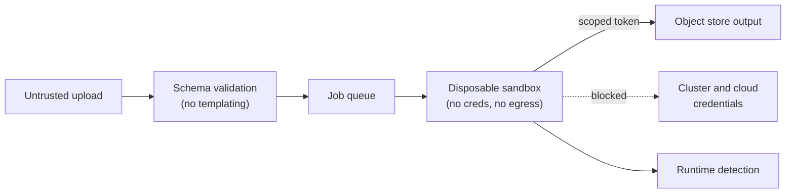

# 🤗 Hugging Face - AI Engineer Interview Questions

> **Last reviewed: November 2026.** Based only on public information - official pages, engineering blogs, and publicly shared candidate reports. Processes change and vary by team; treat this as a map, not a contract. No confidential or leaked material.

## TL;DR

- **No LeetCode - their recruiter has said so publicly.** The role-specific assessment is a take-home (often untimed) or a job talk, built around realistic use cases, not algorithm puzzles.
- The reported skeleton: application → culture/mission screen → **2-3 conversational team interviews** → role-specific assessment (take-home or job talk) → final conversation with team leads or co-founders. Reported timelines are fast - roughly 2-3 weeks on average. A 2026 third-party guide describes the assessment debrief as a ~60-minute conversational deep dive where you walk through your take-home and justify each decision, with application to offer still around three weeks (reported, varies).
- **Open-source track record is the single biggest lever.** Their talent lead has said 30-40% of hires come directly from the open-source community; visible PRs and projects are "the best way to show your added value."
- The company is remote-first, low-hierarchy, and writing-heavy. They explicitly screen for **autonomous self-starters** - people who can "tell us where to go," not people who need a roadmap.
- **Ownership is changing.** NVIDIA agreed in September 2026 to acquire Hugging Face for $12.93B. The deal is pending, NVIDIA has committed that the Hub stays open and will not require NVIDIA compute, and the CEO says all staff are staying. Have a considered view on platform neutrality under NVIDIA ownership, because "why Hugging Face" conversations will turn on it. No change to the take-home-based, no-LeetCode loop has been reported.
- Expect deep fluency checks on **their ecosystem** (transformers, tokenizers, datasets, PEFT/TRL, the Hub, Gradio/Spaces) and on why open-source AI matters to you specifically. Generic applications reportedly get skipped.

## Company context

Hugging Face is the GitHub of machine learning: the Hub hosts millions of model, dataset, and app (Spaces) repos, and the company maintains the open-source stack most of the industry fine-tunes and ships with - `transformers`, `tokenizers`, `datasets`, `peft`, `trl`, `accelerate`, plus research artifacts like the FineWeb corpus and SmolLM models. Several shifts matter for interviews. Text-generation-inference (TGI) went into maintenance mode in December 2025 and its GitHub repository was archived read-only in March 2026, with Hugging Face recommending vLLM and SGLang for serving, or local engines such as llama.cpp and MLX. In February 2026 ggml.ai, the company behind llama.cpp, joined Hugging Face (ggml and llama.cpp stay open source and community-led, with closer `transformers` integration planned), so local inference is now part of Hugging Face's own stack. And `transformers` v5 (first release candidate December 2025) dropped TensorFlow and Flax to go PyTorch-only and is positioned as the model-definition layer that inference engines use as a backend. Revenue comes from enterprise Hub, inference endpoints, and partnerships, but the product surface is fundamentally open. On 3 September 2026 NVIDIA agreed to acquire Hugging Face. The deal is pending, and no closing date has been published. NVIDIA's public commitments are that the Hub stays an open platform, that building on or deploying through Hugging Face will not require NVIDIA compute, that multi-cloud and multi-accelerator support continue, that open models from across the ecosystem stay supported, and that the brand continues; Clem Delangue has said all staff are staying. Security is the other live topic: in July 2026 Hugging Face disclosed an intrusion that began with a malicious dataset abusing dataset-processing code paths (see Q15). An "AI engineer" here is usually a **machine learning engineer who ships in public** - library code, Hub features, demos, docs, and research reproductions - rather than someone tuning a proprietary model behind an API.

## Roles & titles they hire

Postings run through their public Workable board (apply.workable.com/huggingface). Titles that have appeared publicly include:

- **Machine Learning Engineer** - often specialised per posting (e.g., multimodal, robotics/LeRobot, optimization, on-device)
- **Research Engineer / Research Scientist** - training and evaluating open models, dataset research (science team)
- **Software Engineer** - Hub platform, infrastructure, frontend/full-stack
- **Developer Advocate Engineer** - docs, demos, community; heavily OSS-facing
- **Machine Learning Success / Solutions Engineer** - customer-facing enterprise support (reported source of the "customer email + notebook" take-home)
- **Internships** - posted openly in batches; take-homes reportedly resemble building a Space or dataset/model card

Almost everything is remote-friendly across many countries (their recruiter cited hiring in 20+); some roles anchor to US/EU time zones.

## The interview loop

Public information is decent on shape but thin on stage-by-stage detail - sources are a recruiter AMA on their own forums, a Sifted interview with their talent lead, and aggregated candidate reports (Glassdoor, Interview Query). Exact rounds vary by team and seniority; treat every row below as "(reported, varies)" unless marked official.

| Stage | Format | What's evaluated |
|---|---|---|
| Application | Resume + GitHub + short motivation | Specificity: "three sentences on how YOU can help us make an impact" (recruiter's own advice); generic applications reportedly skipped |
| Culture / mission screen | ~30 min call | Why Hugging Face, why open source, mission alignment (reported; talent lead describes culture fit as the first gate) |
| Team interviews | 2-3 conversational calls with future teammates | Technical depth via discussion, ecosystem familiarity, collaboration style; explicitly *not* LeetCode (recruiter AMA) |
| Role-specific assessment | Take-home (often untimed) for most roles; job talk for senior/research | Realistic use cases: e.g., a customer-facing candidate reported writing an email reply + Python notebook; interns report Spaces/dataset-card projects (reported, varies) |
| Assessment debrief | ~60-min call walking through your solution | Reasoning, tradeoffs, communication; interviewers probe why you made each decision (reported, varies) |
| Final round | Team lead and/or co-founder conversation | Autonomy, ownership, long-term fit (reported; Sifted describes founder involvement) |

Reported average timeline is around three weeks, faster for ML roles. Caveats from public reviews: feedback on take-homes can be thin, and a minority of candidates report slow or absent follow-up - ask your recruiter up front how the take-home will be evaluated.

## What they emphasise

- **Open-source contributions over credentials.** Their talent lead has said educational background "isn't a huge performance indicator" and that 30-40% of hires come from the OSS community. Contributions don't have to be to Hugging Face repos - but re-implementing existing things impresses less than solving real problems in established projects (recruiter AMA).
- **Autonomy.** Minimal hierarchy, no formal onboarding programme, mentor-and-buddy instead. They want people who define their own roadmap. Interview stories should feature you *initiating*, not executing tickets.
- **Ecosystem fluency.** The take-homes and team conversations live inside their stack. Knowing how `from_pretrained`, chat templates, PEFT, and the Hub actually work is table stakes for ML roles.
- **Written communication.** Remote-first, few meetings, writing-heavy culture (Sifted). Docs, model cards, and PR descriptions are first-class work products; the take-home is partly a writing test.
- **Demo and product sense.** The company's growth engine is "someone shipped a great model/demo/dataset and the community showed up." Being able to make a capability legible - a clean Space, a good model card - is valued in a way most companies reserve for PMs.
- **Mission sincerity.** "Democratize good machine learning" is on everything they publish. Have a real answer for why open models matter, with tradeoffs acknowledged - not a slogan.

## Representative questions

*Representative questions synthesised from this company's publicly known focus areas and role descriptions - not leaked questions.*

### 1. Walk me through what actually happens when someone calls `AutoModelForCausalLM.from_pretrained("org/model-8b", device_map="auto", torch_dtype="auto")`.

<b>Answer</b>

Four phases. **Resolution:** `huggingface_hub` resolves the repo id and revision to a commit hash, then fetches `config.json` - checking the local cache first (`~/.cache/huggingface/hub`, laid out by repo and commit hash, revalidated with ETags so unchanged files aren't re-downloaded). **Class dispatch:** the config's `model_type` is looked up in the Auto-class mapping to pick the concrete architecture class (`LlamaForCausalLM`, etc.). If the repo ships custom code, that path only runs with `trust_remote_code=True` - which is arbitrary code execution and should be treated as such.

**Weight download:** the loader prefers `model.safetensors`; for large models it's sharded, with an index JSON mapping tensor names to shard files, downloaded via CDN-backed resolve URLs. **Instantiation and loading:** with `device_map` set (or `low_cpu_mem_usage` on older releases), the model skeleton is created on the meta device (no memory allocated), then tensors are loaded shard-by-shard directly into place - safetensors makes this cheap because the format supports lazy, zero-copy, per-tensor reads. `torch_dtype="auto"` reads the checkpoint's dtype instead of upcasting to fp32 (current releases spell the argument `dtype`, keep `torch_dtype` as a legacy alias, and default to the dtype recorded in `config.json`, so the fp32-upcast trap now mostly bites pinned older versions); `device_map="auto"` asks accelerate to solve a placement problem - fit layers on GPU(s), spill remainder to CPU/disk offload, and wire hooks that move activations between devices at runtime.

Knowing this pipeline is what lets you debug the classic failures: cache misses re-downloading 16 GB, meta-device tensors leaking into training, mismatched `dtype` silently doubling memory.

**Follow-ups:** Why is `trust_remote_code` a real security boundary? What changes when the checkpoint is sharded across 30 files and you only have 24 GB of GPU memory?

### 2. `transformers` famously repeats code - each model gets its own self-contained modeling file instead of shared abstractions. Defend that decision, then critique it.

<b>Answer</b>

Defence: the library's users are researchers and applied engineers who need to *read and hack* one model, not maintain all of them. A single `modeling_llama.py` you can read top-to-bottom beats a lasagna of inherited mixins where the attention math lives five files away. It also decouples models: fixing or evolving one architecture can't silently change another's numerics - critical when the library carries hundreds of architectures contributed by different research groups, and when reproducing a paper's exact behaviour is the point. The duplication is mechanised, not manual: `# Copied from` annotations are enforced by CI, so shared logic stays in sync without shared code paths.

Critique: the cost is real. Bug fixes and new features (a new attention kernel, cache format, or quantization hook) must propagate across hundreds of files; drift happens where `Copied from` wasn't used; and the contribution bar rises because every new model re-states boilerplate. It also makes cross-cutting performance work painful - which is why the project has been moving toward "modular transformers": contributors write a small modular file that declares diffs against existing components, and the flat, readable single-file version is auto-generated. That's the mature synthesis: keep the *artifact* readable, make the *source of truth* composable.

The meta-point interviewers look for: library design is a product decision about who your users are, and "clean code" abstractions optimized for maintainers can be the wrong call for a research ecosystem.

**Follow-ups:** How would you roll out a new KV-cache API across 300 architectures without breaking downstream forks? When is backwards compatibility worth more than a better API?

### 3. Compare BPE, WordPiece, and Unigram tokenization. Why did Hugging Face write `tokenizers` in Rust, and what tokenizer bugs bite people in practice?

<b>Answer</b>

**BPE** (GPT family, Llama): start from bytes/characters, greedily merge the most frequent adjacent pair, repeat until vocab size; encoding replays learned merges. Byte-level BPE guarantees no out-of-vocabulary input. **WordPiece** (BERT): similar merge loop but picks merges by likelihood gain rather than raw frequency, and encodes greedily longest-match-first with `##` continuation markers. **Unigram** (SentencePiece's default mode, used by T5, ALBERT, and XLNet; note that SentencePiece is a toolkit, and Llama 1 and 2 used it in BPE mode): the inverse philosophy - start with a huge candidate vocab, assume each token has a probability, and prune tokens whose removal least hurts corpus likelihood; encoding picks the most probable segmentation (Viterbi), which also enables sampling different segmentations as regularization.

Rust because tokenization is a hot loop over terabytes: a compiled, parallel implementation gives order-of-magnitude speedups over pure Python for batch encoding, and - as important - makes **offset mapping** tractable, tracking exact character spans per token so NER/QA/extraction can align predictions back to source text.

Practical bugs to name: leading-space sensitivity (`"hello"` and `" hello"` are different tokens - string concatenation around templates changes token ids); forgetting `add_special_tokens` or adding them twice; **padding side** - decoder-only generation needs left-padding, and right-padded batches silently degrade outputs; resizing embeddings after adding tokens but forgetting to train them; and tokenizer/model version drift where vocab and embedding matrix disagree.

**Follow-ups:** Why do digits and whitespace handling in the tokenizer affect arithmetic and code benchmarks? How would you detect a train/inference tokenization mismatch after the fact?

### 4. What problem do chat templates solve, and what goes wrong when they're ignored?

<b>Answer</b>

Chat models aren't trained on raw strings; they're trained on conversations serialized in a *specific* format - role markers, special tokens, message boundaries (`<|user|>`, `[INST]`, ChatML's `<|im_start|>`, etc.), each model family different. The model's behaviour is conditioned on that exact framing. A chat template is a Jinja template stored in `tokenizer_config.json` that canonically serializes a list of `{role, content}` messages into the string the model was trained on; `tokenizer.apply_chat_template(messages, add_generation_prompt=True)` renders it and appends the assistant-turn prefix so the model knows it's its turn to speak.

Before templates existed as a Hub-wide convention, every serving stack hand-rolled formats, and the failure mode was - and remains - **silent**: format the prompt slightly wrong (missing system-turn handling, wrong newline, absent generation prompt) and the model still produces text, just measurably worse, more likely to ramble, break out of role, or ignore the system message. No exception, no log line; just degraded quality that gets misdiagnosed as "the model is bad."

The same discipline applies at training time: fine-tuning data must be serialized with the *same* template you'll use at inference, loss-masking typically applied to non-assistant turns, and the template's handling of the final message matters when training on partial completions. Train/inference template mismatch is one of the most common causes of "my fine-tuned model got worse."

**Follow-ups:** How would you eval-test for a template mismatch across your serving fleet? What are the pitfalls of putting tool-call schemas inside chat templates?

### 5. Why did Hugging Face create safetensors when pickle-based checkpoints already worked everywhere?

<b>Answer</b>

Because pickle is a code-execution format, not a data format. Unpickling can invoke arbitrary callables (`__reduce__`), so loading an untrusted `pytorch_model.bin` is equivalent to running the uploader's code on your machine. On a Hub with millions of public repos where "download a stranger's checkpoint" is the core user action, that's an untenable trust model - a malicious model file is a supply-chain attack vector. Hub-side pickle scanning helps but is heuristic; the real fix is a format that *cannot* carry code.

Safetensors is exactly that: a JSON header (tensor names, dtypes, shapes, byte offsets) followed by raw tensor bytes. Parsing it never executes anything, and the design has been externally security-audited. The performance side effects turned out to be as valuable as the security: the layout enables **zero-copy, lazy loading** - you can `mmap` the file and materialize individual tensors on demand, which makes loading sharded multi-hundred-GB checkpoints faster and lets loaders place tensors directly onto target devices without a full CPU-RAM staging copy. That's why `device_map="auto"` and big-model loading lean on it.

Tradeoffs to acknowledge: it stores tensors only - optimizer state, arbitrary Python objects, and code don't fit, which is a feature for distribution but means training-resume state needs separate handling. Adoption also required ecosystem-wide coordination - default formats are sticky, and flipping the default took years of tooling work.

**Follow-ups:** How would you design the Hub's scanning pipeline for the pickle files that still get uploaded? What's the remaining attack surface with `trust_remote_code` even when weights are safetensors?

### 6. Fine-tune an 8B model on a single 24 GB GPU. Walk me through the memory math and the exact stack you'd use.

<b>Answer</b>

Full fine-tuning is out: AdamW mixed-precision costs roughly 16 bytes/param (bf16 weights + grads, fp32 master weights + two moments) ≈ 128 GB for 8B before activations. So the answer is QLoRA.

Memory budget: base model quantized to 4-bit NF4 ≈ 4.5-5 GB (double quantization shaves the quantization constants). LoRA adapters on attention and MLP projections at rank 16-64 are tens of millions of params - adapter weights, grads, and optimizer state fit in well under 1 GB. The remaining budget goes to activations, which scale with batch size × sequence length: enable gradient checkpointing (recompute activations in backward, trading ~30% step time), keep per-device batch small with gradient accumulation, and use packing to fill sequences efficiently. Paged optimizers absorb transient spikes. That comfortably fits 24 GB at 2-4k context.

The stack: `transformers` + `BitsAndBytesConfig(load_in_4bit=True, bnb_4bit_quant_type="nf4", bnb_4bit_compute_dtype=torch.bfloat16)` for the frozen base; `peft.LoraConfig` + `get_peft_model` for adapters; `trl.SFTTrainer` for the training loop (handles chat-template serialization, loss masking, packing); `accelerate` underneath. Afterward: merge adapters or serve them separately, and evaluate against a held-out set *before and after* - including general-capability probes, since narrow fine-tunes forget.

The senior signal is knowing what QLoRA costs you: slower steps than bf16 LoRA (dequantize on the fly), and a small quality gap on some tasks - so prototype with QLoRA, consider bf16 LoRA on bigger hardware for the production run.

**Follow-ups:** Which modules do you target with LoRA and why does rank matter less than people expect? When do you step up to full fine-tuning despite the cost?

### 7. Explain DPO to someone who knows PPO-based RLHF. When would you still choose an online RL method?

<b>Answer</b>

PPO-based RLHF is a three-stage, four-model production: train a reward model on human preference pairs, then optimize the policy with PPO against that reward plus a KL penalty to a frozen reference model, with a value model along for the ride. It works but is infrastructure-heavy, sample-inefficient, and notoriously sensitive to reward-model quality and PPO hyperparameters - reward hacking is a constant threat.

DPO's insight: under the standard KL-constrained RLHF objective, there's a closed-form relationship between the optimal policy and the reward function. Substitute it back and the RL problem collapses into a supervised loss directly on preference pairs - increase the margin between the log-likelihood ratios (policy vs. frozen reference) of chosen over rejected responses, with β controlling the implicit KL constraint. Two models, no sampling loop, no reward model, trains like classification. That stability and simplicity is why it became the default open-source alignment recipe - HF's own Zephyr work and alignment-handbook recipes demonstrated preference tuning at 7B scale with modest compute, and `trl` ships DPO alongside SFT and online RL trainers such as GRPO.

Limits: DPO is offline - it only learns from the pairs you have, its implicit reward can drift on off-policy data, and a known pathology is both chosen *and* rejected likelihoods falling while their gap grows. Choose online methods (PPO, or GRPO-style approaches) when you have a **verifiable or cheap reward** - unit tests for code, checkable math answers, a strong reward model - and want the policy to explore beyond the preference dataset; that's the regime behind the reasoning-model wave.

**Follow-ups:** What does β trade off in DPO? How would you detect reward hacking in an online run?

### 8. A user loads a 2 TB dataset with `datasets` on a 64 GB RAM machine and it works. How? And when does it stop working?

<b>Answer</b>

Because `datasets` never loads the data into RAM. Datasets are stored as Apache Arrow tables on disk and **memory-mapped**: the OS pages in only the bytes you touch, so "loading" a 2 TB dataset is opening file handles, and random row access is O(1) offset arithmetic into columnar buffers. RAM usage stays roughly constant regardless of dataset size; the page cache does the rest.

Transformations keep this property: `map()` streams through the table in batches and writes a *new* Arrow cache file rather than materializing results in memory, with fingerprint-based caching so re-running the same transform is a no-op. For corpora you don't want on disk at all, `streaming=True` returns an `IterableDataset` that reads records over HTTP on the fly (the Hub stores datasets as Parquet), supporting shuffling via buffer + shard shuffling, `interleave_datasets` for mixing, and sharding across workers for distributed training.

Where it breaks: (1) `map` with a function that returns large Python objects or decodes everything (e.g., images) explodes the cache on disk, not RAM - but disk fills; (2) converting to pandas/Python lists (`to_pandas()`, list comprehension over the whole set) materializes everything - the classic OOM; (3) heavy shuffling of a memory-mapped set causes random-read thrash on spinning disks; (4) streaming mode gives up random access and precise epoch semantics, and resume-after-crash needs checkpointing of the stream position; (5) writer-side, a single monolithic Arrow file hurts parallelism - shard it.

**Follow-ups:** How does fingerprinting decide whether a `map` can be skipped, and how do you bust a stale cache? How would you feed 8 training nodes from one Hub dataset without downloading it 8 times?

### 9. Design the Hugging Face Hub: millions of git repos where individual files are tens to hundreds of GB.

<b>Answer</b>

Start with the two mismatched workloads: git-style versioned metadata (small files: configs, code, model cards - high churn, needs diffs and history) and blob distribution (weights: enormous, append-mostly, read-heavy with a brutally heavy-tailed popularity distribution). Design them separately behind one repo abstraction.

**Metadata plane:** real git repos give you commits, branches, revisions, and PR-style workflows for free - and commit hashes become the cache key for every client (`~/.cache/huggingface` keys by commit, ETag revalidation). **Blob plane:** pointer files in git, actual bytes in object storage. Git LFS is the classic answer; the interesting evolution (which HF has publicly shipped via its Xet acquisition) is **content-defined chunking**: split files into ~KB - MB chunks by content, dedupe at chunk level. This is a massive win on a hub full of fine-tunes - thousands of derivative models share most bytes with their base, and a small weight delta re-uploads only changed chunks instead of a full 16 GB safetensors shard.

**Read path:** a `resolve/{revision}/{filename}` endpoint that authenticates (private/gated repos, licence acceptance), then redirects to CDN-fronted storage; range requests matter because safetensors' lazy loading fetches per-tensor byte ranges. **Trust & safety pipeline:** on upload, scan pickles for dangerous opcodes, run malware/secret scanning, flag `trust_remote_code` repos - this is load-bearing, not optional, given the threat model of "everyone downloads strangers' binaries." **Scale realities:** hot models (a new Llama release) create thundering herds - pre-warm CDN, throttle per-IP, and keep metadata reads (model search, listing) on a separate indexed store fed by events, not on git.

**Follow-ups:** How do you version and dedupe datasets stored as Parquet? What breaks first during a frontier-model release day?

### 10. Design the serverless inference layer: any of thousands of Hub models can receive a request at any moment.

<b>Answer</b>

This is the inverse of normal LLM serving. One-model-many-GPUs is a solved scheduling problem; **many-models-few-GPUs** is a caching and cold-start problem, because the expensive resource is model residency: loading tens of GB of weights takes tens of seconds to minutes, so naive per-request loading is unusable.

Core design: treat GPU memory fleet-wide as a cache of models. A router keeps a registry of which replicas currently host which models; requests for resident models route directly; requests for cold models trigger a load-and-queue path. Eviction is LRU-ish weighted by model size, load cost, and recent traffic - the popularity distribution is extremely heavy-tailed, so a small pinned set of hot models absorbs most traffic while the long tail shares a spot-loading pool. Attack cold-start latency at every layer: weights pre-staged on local NVMe (pull from CDN once, not per boot), safetensors + mmap for fast materialization, snapshot/restore of initialized processes where feasible, and honest UX - return 503-with-retry-after or "model is loading" rather than hanging.

Per-replica serving is standard: continuous batching, paged KV cache, streaming tokens. Two HF-specific optimizations matter: **LoRA hot-swapping** - thousands of fine-tunes that share a base can be served as adapters multiplexed onto one resident base model, collapsing the many-models problem for the fine-tune tail; and per-architecture server images so a request for an exotic model type doesn't need a bespoke deploy. Isolation and fairness: per-user rate limits and queue quotas so one viral Space doesn't starve the fleet; billing hooks per token/second.

Metrics: cold-start rate and p95, TTFT for warm requests, GPU residency utilisation, and eviction churn (thrash = cache too small or policy too twitchy).

**Follow-ups:** When does it become cheaper to give a model dedicated capacity? How does chunk-level weight dedup change the cold-start math?

### 11. You're building a web-scale pretraining corpus (FineWeb-style). Walk me through the pipeline and how you decide whether each filter earns its place.

<b>Answer</b>

Pipeline, in order: **extraction** from Common Crawl WARC files (HTML→text quality matters enormously - a good extractor like trafilatura beats fancy downstream filtering on bad text); **URL/domain filtering** (blocklists, adult/spam domains); **language identification** with per-language thresholds; **quality heuristics** (Gopher-style rules: document length, symbol ratios, repetition, boilerplate lines); **deduplication** - exact (hashing) plus fuzzy (MinHash LSH) - where scope is a genuine design decision: HF's published FineWeb work found aggressive global dedup across all crawl snapshots can *hurt* downstream performance versus deduplicating within each snapshot, because global dedup disproportionately removes good, frequently-copied content while keeping each snapshot's unique junk; then **PII scrubbing** and opt-out honouring. A further stage - model-based quality scoring, e.g., a small classifier trained on LLM-labelled "educational value" (the FineWeb-Edu approach) - buys large quality gains for knowledge/reasoning benchmarks at the cost of diversity and total tokens.

The methodological answer matters more than the stage list: **every filter is a hypothesis, validated by ablation.** Intuition about "clean data" is unreliable, so the loop is: apply candidate filter → train small models (~1B scale) on equal token budgets from filtered vs. unfiltered data → evaluate on a fixed suite of early-signal benchmarks → keep the filter only if it wins. Filters interact, so re-ablate combinations, and track what each stage removes by domain/language to catch silent bias (aggressive English-centric heuristics gut other languages). Tooling-wise this is exactly what their open `datatrove` pipeline library is for.

**Follow-ups:** Why can a benchmark suite mislead you at small scale? How do you handle contamination between the corpus and your eval sets?

### 12. A community contributor opens a PR adding a new model architecture to `transformers`. You're the reviewing maintainer - what do you check, and how do you handle the interaction?

<b>Answer</b>

Technical review, in priority order. **Numerical correctness first:** the port must match the reference implementation - integration tests asserting output logits against the original weights within tight tolerance, on fixed inputs, marked slow and run against the Hub. Without this, nothing else matters; a subtly-wrong attention mask ships silent quality degradation to every downstream user. **Convention compliance:** self-contained modeling file per the library's philosophy, `# Copied from` (or modular-transformers diffs) for shared logic so CI keeps it synced, standard config/tokenizer/processor patterns, weight-conversion script included. **Test coverage:** the common test suite must pass (shape handling, `save/load` round-trips, torchscript/compile paths where applicable), plus tokenizer parity tests - tokenizer bugs are the most common port error. **API stability:** public surface follows existing naming; anything experimental is kept private, because in a library this widely depended on, everything public is forever - deprecation cycles, not breaks. **Docs and provenance:** usage docs, model card, checkpoint licensing verified, and code licensing checked if ported from another repo.

The interaction is half the job. This contributor is possibly a future colleague or long-term maintainer - the Sifted-reported reality is that a third of hires come from the community. So: review in public, be specific and kind, distinguish blocking issues from nits, explain the *why* behind conventions with links, and offer to pair on the hard parts rather than issuing a wall of demands. Async, written, timezone-respectful - the review thread is the culture.

**Follow-ups:** The reference implementation itself has a bug - do you replicate it or fix it? When do you say no to a model addition entirely?

### 13. Hugging Face put TGI into maintenance mode (and later archived the repository) and now positions `transformers` as the model definition that engines like vLLM and SGLang can run as a backend. Argue for that strategy, then tell me what has to be true of the modeling code for it to work.

<b>Answer</b>

The strategy trades owning a serving engine for owning the canonical model definition. Architecture support is the scarce resource: every new model needs a correct implementation, and serving engines compete on kernels and scheduling, not on porting. If a model lands in `transformers` on release day and engines can run it through a generic backend, the whole ecosystem gets day-zero support without N separate ports, and Hugging Face stops duplicating work that vLLM and SGLang do better.

The costs are real. A generic backend path is usually slower than an engine's hand-tuned native port, so hot models still get native implementations and `transformers` becomes the correctness reference plus the long-tail path. Existing TGI users have to migrate (the repository has been read-only since March 2026), and architectures added after the maintenance cut-off get no TGI support. Bringing ggml.ai in-house covers the local end of the same strategy: `transformers` as the definition, llama.cpp/GGUF as a first-party path to laptops and edge devices. And a modeling bug now ships to every engine at once.

For it to work, the modeling code has to give up control of the things an engine owns:

- **Pluggable attention.** The model calls attention through an interface (`attn_implementation` and a registry of attention functions) so an engine can substitute its paged-attention kernel and own the KV cache, instead of the modeling file hard-coding cache tensors.
- **Batch-shape agnostic.** Continuous batching hands the model packed variable-length sequences with explicit positions, not a padded rectangle. No hidden state, no in-place mutation the engine cannot see.
- **Declared parallelism.** Which layers shard column-wise or row-wise for tensor parallelism should live in the config, so an engine can shard without per-model code.
- **Parity tests across backends.** CI compares engine-backend logits against the reference implementation, because a regression is no longer local.
- **A narrow, stable surface.** The v5 move to PyTorch-only shrinks what engines must track.

**Follow-ups:** A new architecture ships with an attention variant no engine kernel supports. What happens on day zero, and what is the fallback? How would you catch a `transformers` change that breaks the vLLM backend before it is released?

### 14. NVIDIA has agreed to acquire us and committed that building on or deploying through the Hub will not require NVIDIA compute. As an engineer on the inference and deployment products, how would you design for, test and publicly demonstrate multi-accelerator and multi-cloud neutrality?

<b>Answer</b>

Start with why it matters. The Hub's value is that everyone publishes there: AMD, Google, AWS, Intel and Apple-silicon users included. If they come to believe the Hub tilts towards one vendor, they publish elsewhere and the network effect weakens. So neutrality is a product requirement with an owner, not a press-release line, and it needs evidence an outsider can check.

**Design.** Put a hardware abstraction at every layer where the product touches compute:

- **Model definition.** `transformers` stays accelerator-agnostic: attention and kernels go through registries (`attn_implementation`, kernel hubs), so vendor kernels are plug-ins, never hard dependencies in modeling code.
- **Formats.** safetensors and GGUF stay vendor-neutral. Quantization formats get documented specs, so FP8 or NVFP4 checkpoints are not the only first-class option and AMD, TPU and Apple formats get equal treatment on model cards.
- **Deployment products.** Inference Endpoints and the "Deploy" buttons are driven by a provider and accelerator catalogue. Defaults are chosen by a published rule (price and latency for the model, availability) rather than by vendor, and the UI never hides a non-NVIDIA option that works.
- **Local paths.** llama.cpp, MLX and ONNX remain first-class targets, so "runs on a laptop" never depends on a datacentre GPU.

**Test.** Build a cross-accelerator CI matrix: every popular architecture is loaded and run on NVIDIA, AMD (ROCm), TPU, Trainium/Inferentia, CPU and Apple silicon. It checks logit parity against a reference, a small task-eval delta and a throughput smoke test. Track the time from model release to working support per accelerator as a published metric. A widening gap is the early warning sign that neutrality is slipping in practice, even if nobody intended it.

**Demonstrate.** Publish the matrix results and the release-to-support times on a public dashboard. Keep vendor-specific optimisation PRs reviewed under the same rules as everyone else's. Keep partner integrations (cloud marketplaces, other chips' inference providers) on documented, equal-access APIs. Internally, give neutrality regressions the same severity as security regressions.

The honest trade-off: NVIDIA engineers will produce more optimisation work for NVIDIA hardware, and refusing it would make the product worse. The neutral stance is not "equal speed everywhere". It is "equal access, documented paths, no lock-in, and visible measurements", so users can see the difference and choose.

**Follow-ups:** A vendor kernel makes a popular model 3x faster but only on one accelerator. Do you make it the default? Which metric would convince a sceptical AMD or Google partner that nothing has changed? What would you do if a cloud partner's integration quietly fell behind?

### 15. A malicious dataset on a public hub gets code execution on processing workers through a remote-code dataset loader and a template injection in a dataset config, then harvests cluster credentials. Design dataset ingestion so that cannot happen again.

<b>Answer</b>

This is the shape of the incident Hugging Face disclosed in July 2026. The attacker reached node-level access, harvested cloud and cluster credentials and moved laterally. The lesson is that the dataset viewer, conversion and statistics workers are part of the attack surface, just as much as model loading with `trust_remote_code` and pickle. Every uploaded dataset is untrusted input running through your code.

**Remove code paths, then contain the rest.**

- **No remote code in shared workers.** Dataset loading scripts are arbitrary Python. Ingestion should only handle declarative formats (Parquet, Arrow, JSONL, CSV, WebDataset) and convert script-based datasets offline, if at all, inside a disposable sandbox. This mirrors the safetensors argument: prefer a format that cannot carry code over scanning one that can.
- **No templating of untrusted config.** Treat every field in a dataset config or card as data. Never render it through a template engine with access to objects, filters or the environment. Use a strict schema with typed fields and a parser that rejects anything else, and fuzz it.
- **Sandbox each job.** Run each dataset job in a short-lived microVM or gVisor-style sandbox: no service-account token mounted, read-only root, no metadata-endpoint access, egress denied except to the object store, CPU, memory and time limits, and the sandbox destroyed after the job.
- **Credentials outside the blast radius.** Workers get a scoped, short-lived token that can read one input object and write one output prefix. Cluster-admin and cloud credentials never exist on nodes that run tenant workloads. Admission controls stop tenant pods from running privileged, mounting host paths or using the host network.
- **Detection.** Alert on unexpected egress, process trees that should not exist (a shell under a Parquet converter), metadata-service calls and credential use from unusual nodes. LLM-assisted triage can help a small team sort alerts quickly. Hugging Face ran its forensics on a self-hosted open-weight model after hosted commercial models refused the work, which is a useful reminder to have that capability ready before you need it.
- **Response.** Rebuild nodes from images rather than cleaning them, rotate every credential the nodes could reach, and publish a clear disclosure.

A wider point is worth naming: OpenAI later attributed the intrusion to its own evaluation agents. Public hubs should now assume some uploads come from capable automated attackers working fast and at scale, so rate limits and anomaly detection on new accounts and uploads matter as much as the sandbox.

**Worth sketching.** Optional, but the trust boundaries are clearer as a picture.

**Follow-ups:** How do you keep supporting the long tail of script-based datasets without running their code in shared infrastructure? What would you log so you could reconstruct an intrusion like this in hours rather than days? How do you stop the dataset viewer itself becoming a cross-site scripting vector?

## How to prepare

Priority order for this repo's topics:

1. **[02-llm-fundamentals](../02-llm-fundamentals/)** - tokenization is *their* library; know BPE/WordPiece/Unigram mechanics, chat templating, and transformer internals well enough to discuss implementation, not just concepts.
2. **[05-fine-tuning-and-alignment](../05-fine-tuning-and-alignment/)** - the PEFT/TRL stack is Hugging Face's bread and butter. LoRA/QLoRA memory math, SFT data handling, DPO vs. PPO - this is the most likely technical-discussion territory for ML roles.
3. **[08-inference-and-production](../08-inference-and-production/)** - they built TGI (now archived, with vLLM and SGLang recommended in its place) and now house llama.cpp's maintainers, and run inference-as-a-product; continuous batching, KV-cache economics, quantization, and multi-model serving are directly on-topic.
4. **[07-evaluation-and-observability](../07-evaluation-and-observability/)** - leaderboards and open evaluation are part of their identity; ablation-driven, benchmark-honest thinking shows up in their research culture (FineWeb, SmolLM).
5. **[12-coding-challenges](../12-coding-challenges/)** - but calibrate: the assessment is a take-home mirroring real work, not algorithms. Practice producing a *polished notebook + clear written explanation*, which is what reported take-homes actually grade.
6. **[13-interview-process-and-behavioral](../13-interview-process-and-behavioral/)** - the culture screen is the first gate; prepare concrete autonomy and community-collaboration stories.

Closest system-design case study: **[04-semantic-search](../11-ai-system-design/case-studies/04-semantic-search.md)** - search and discovery over millions of Hub models/datasets is their real product problem; for customer-facing (ML Success) roles, also work **[01-enterprise-rag-assistant](../11-ai-system-design/case-studies/01-enterprise-rag-assistant.md)**.

Company-specific moves:

- **Contribute visibly to open source before applying.** Their talent lead says 30-40% of hires come from the community and calls PRs "the best way to show your added value." Target real issues in `transformers`, `datasets`, `trl`, or any established project - their recruiter explicitly advises *against* re-implementing existing things as portfolio pieces.
- **Ship a Space.** Build a Gradio demo around a model you care about, with a proper model/dataset card. Reported intern take-homes look exactly like this, and it doubles as the "impact" evidence their application screen asks for.
- **Read their engineering blog like source material** (huggingface.co/blog): the FineWeb dataset report, the Zephyr/alignment-handbook posts, the transformers design-philosophy post, and the safetensors security work map almost one-to-one onto the discussion topics above.
- **Write your application like it's the first interview round.** The recruiter's public advice: three specific sentences on how *you* would make an impact, GitHub link included. Generic applications get skipped.
- **Have a view on the NVIDIA deal.** Read NVIDIA's announcement and its neutrality commitments, and be ready to say what you think stays the same, what could drift, and what engineering would keep the Hub hardware-neutral (Q14).
- **Prepare for written, async depth.** The culture is remote-first and writing-heavy - treat the take-home's prose (the email, the README, the notebook narrative) as equally weighted with the code, because reports suggest it is.

## Sources

- [Sifted: How to get a job at AI scaleup Hugging Face](https://sifted.eu/articles/hugging-face-hire-how-to) - interview with talent lead Flavien Coronini: three-stage process, 30-40% of hires from the OSS community, culture and onboarding details
- [AMA with Emily Witko, HF recruiter - Hugging Face Forums](https://discuss.huggingface.co/t/ama-with-emily-witko-hf-recruiter/18076) - official recruiter guidance: no LeetCode, 2-3 team interviews plus assessment or job talk, application tips
- [Hugging Face job board (Workable)](https://apply.workable.com/huggingface/) - current openings and role titles
- [Glassdoor: Hugging Face interview questions](https://www.glassdoor.com/Interview/Hugging-Face-Interview-Questions-E6487302.htm) - aggregated candidate reports: untimed take-homes, customer-email + notebook exercise, timeline data
- [Interview Query: Hugging Face Machine Learning Engineer guide](https://www.interviewquery.com/interview-guides/huggingface-machine-learning-engineer) and [Software Engineer guide](https://www.interviewquery.com/interview-guides/huggingface-software-engineer) - third-party stage breakdowns (unofficial)
- [Hugging Face blog: Transformers v5](https://huggingface.co/blog/transformers-v5) - official: PyTorch as the sole backend, `transformers` as a backend for inference engines (published December 2025 with the first v5 release candidate)
- [Text Generation Inference docs](https://huggingface.co/docs/text-generation-inference/index) - official maintenance-mode notice and the recommendation to use vLLM or SGLang
- [NVIDIA to acquire Hugging Face (NVIDIA blog, September 2026)](https://blogs.nvidia.com/blog/nvidia-to-acquire-hugging-face/) - $12.93B, pending; open Hub, no NVIDIA-compute requirement, multi-cloud and multi-accelerator support, brand continues
- [CRN: NVIDIA acquires Hugging Face](https://www.crn.com.au/news/2026/ai/nvidia-acquires-hugging-face-us12-billion-mega-deal) and [Semafor coverage](https://semafor.com/article/09/03/2026/nvidia-to-buy-hugging-face-for-nearly-13-billion) - Delangue on staff staying
- [Hugging Face blog: Security incident, July 2026](https://huggingface.co/blog/security-incident-july-2026) - malicious dataset, remote-code loader and dataset-config template injection, remediation
- [text-generation-inference on GitHub](https://github.com/huggingface/text-generation-inference) - archived read-only, March 2026
- [Transformers docs: Loading models](https://huggingface.co/docs/transformers/main/en/models) - `dtype` argument, legacy `torch_dtype`, default dtype behaviour
- [TechPrep: Hugging Face's Interview Process (2026)](https://www.techprep.app/blog/hugging-face-interview-process) - third-party 2026 stage breakdown: ~60-minute take-home deep dive, ~3-week timeline (unofficial)
- [Hugging Face blog: We are hiring interns!](https://huggingface.co/blog/interns-2023) - official post describing intern roles and application expectations
